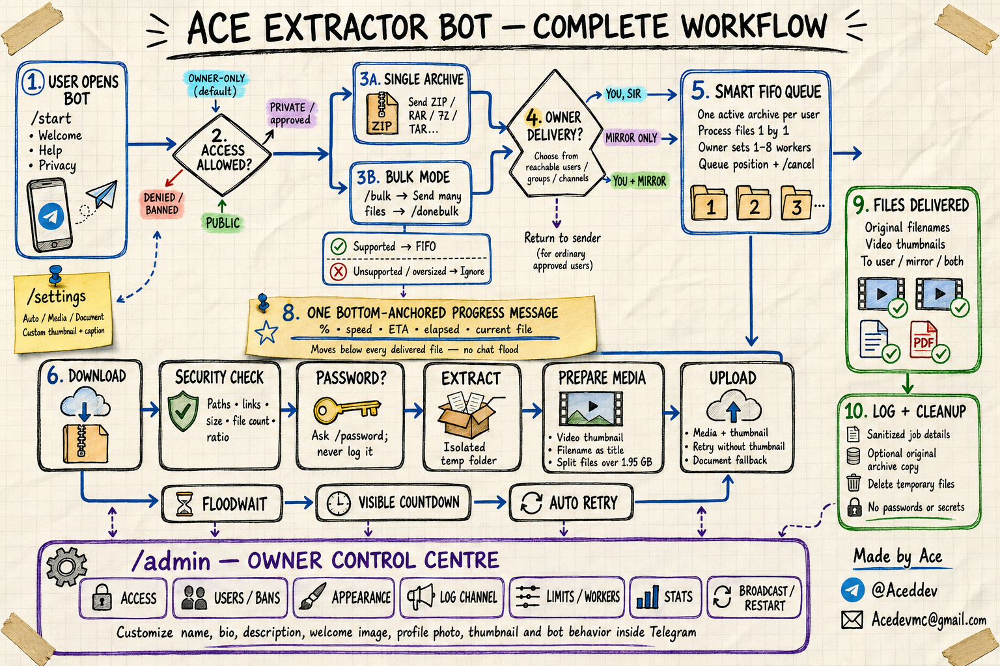

<p align="center">
  
</p>

<h1 align="center">AceUnzipBot</h1>

<p align="center">
  A fast, secure, owner-controlled Telegram archive extractor with polished mobile UI,
  FIFO bulk processing, resilient uploads, automatic thumbnails, and owner-only mirroring.
</p>

<p align="center">
  <a href="https://github.com/Aceddev/AceUnzipBot/actions/workflows/ci.yml"></a>
  <a href="https://github.com/Aceddev/AceUnzipBot/releases"></a>
  
  
  <a href="LICENSE"></a>
</p>

<p align="center">
  <strong>Made by Ace</strong> · <a href="https://t.me/Aceddev">@Aceddev</a> ·
  <a href="mailto:Acedevmc@gmail.com">Acedevmc@gmail.com</a>
</p>

<p align="center">
  
</p>

## Install on an Ubuntu VPS

Run one command on Ubuntu or Debian:

```bash
bash <(curl -fLsS --proto '=https' --tlsv1.2 https://raw.githubusercontent.com/Aceddev/AceUnzipBot/main/install.sh)
```

The terminal wizard asks for:

1. Telegram API ID
2. Telegram API hash
3. Bot token
4. Owner Telegram numeric ID
5. Optional log channel ID

It installs Python, FFmpeg, 7-Zip, RAR support, `cryptg`, and systemd; verifies the credentials
against Telegram without printing secrets; creates an unprivileged `aceunzip` service account;
and starts the bot. The log channel may be left blank. A missing or inaccessible channel never
stops archive processing.

Want to inspect the installer first?

```bash
curl -fLsS https://raw.githubusercontent.com/Aceddev/AceUnzipBot/main/install.sh | less
```

### Reconfigure after installation

Run the control command with no arguments:

```bash
aceunzip
```

It opens the same ACE setup wizard, keeps existing secrets when Enter is pressed, validates the
new values, updates the optional log-channel preference, and restarts systemd. If validation or
restart fails, the previous configuration is restored.

```text
aceunzip status      service status
aceunzip logs        follow logs
aceunzip restart     restart safely
aceunzip doctor      validate dependencies/configuration
aceunzip update      fast-forward a Git installation
```

See [CLI reference](docs/CLI.md) and [VPS deployment details](docs/DEPLOYMENT.md#ubuntu--debian-vps).

## Why AceUnzipBot

- **Focused scope:** archive extraction and Telegram delivery, without torrents, remote shell,
  `/eval`, cloud-drive credentials, or unrelated downloaders.
- **Business-class Telegram UI:** compact phone-width cards, 12-cell progress bars, speed, ETA,
  elapsed time, current file, and cancel controls.
- **One bottom-anchored progress card:** after each delivered file, the status is moved below it;
  bulk collection and queueing use aggregate updates instead of flooding the chat.
- **Every extracted file attempted:** valid photos/videos use Telegram media previews; everything
  else is sent as a document. Zero-byte entries and individual upload failures are skipped and
  reported without rejecting the rest of the archive.
- **Safe defaults:** owner-only access, one FIFO worker, local SQLite/WAL, isolated workspaces,
  automatic cleanup, archive bomb limits, and path/link checks.
- **Owner-controlled:** access, users, appearance, bot profile, logs, limits, statistics,
  broadcasts, and restart are managed from `/admin` inside Telegram.

## Core features

### Archive and delivery engine

- ZIP, RAR, 7Z, TAR, TAR.GZ, GZ, BZ2, XZ, ZST, ISO, and CAB via 7-Zip.
- Password-protected archives; passwords remain in memory and never enter SQLite or log captions.
- Every non-empty regular file is returned regardless of extension.
- Verified JPG/PNG images and MP4/M4V/MOV videos can be sent as media.
- Verified videos receive generated or user-supplied thumbnails and their literal filename as the
  Telegram title/caption.
- Deterministic upload fallback: media plus thumbnail, media without thumbnail, then plain
  document. `MEDIA_FILE_INVALID` on one item cannot cancel the remaining archive.
- Outputs over the safe single-upload size are split into `.part001`, `.part002`, and so on.
- Long Telegram FloodWaits display a countdown and retry the exact operation automatically.

### Queue and bulk mode

- Unlimited application-level submissions, constrained only by Telegram and VPS capacity.
- Strict FIFO ordering per user; owner-selectable global concurrency from one to eight workers.
- `/bulk` starts an in-memory collector, `/donebulk` validates it, and `/cancelbulk` discards it.
- Supported archives are listed in arrival order; unsupported and oversized files are clearly
  flagged and ignored.
- One **All N archives queued** confirmation replaces N individual queue messages.
- Archives download and reserve disk only when a worker is available.

### Owner-only mirroring

For an owner submission, choose **You, Sir**, **Mirror only**, or **You + mirror**. The picker lists
reachable users, groups, and channels already learned through bot updates and successful routes;
no destination ID or username is requested. Each destination is revalidated before queueing.
Ordinary users can never redirect their results.

Telegram does not permit bot accounts to enumerate every dialog. After adding the bot to a quiet
group or channel, send one message or command there, then refresh the destination picker.

### Optional, failure-safe logging

- Leave `LOG_CHANNEL_ID` blank to disable all log delivery.
- Set, test, replace, or disable the channel from `/admin → Logs`.
- Operational events and original archive copies have independent switches.
- Original user captions are not forwarded because they may contain passwords.
- If Telegram rejects a stored archive media reference, the bot falls back to sanitized metadata.
- If the channel is inaccessible, logging is circuit-broken for that run while every job continues.

## Owner control centre

Open `/admin` as the configured owner:

| Area | Controls |
| --- | --- |
| Access | Owner-only, Private allowlist, Public, maintenance |
| Users | Approve, remove, ban, unban, add bot admins |
| Appearance | Name, bio, description, welcome/help text, banner, profile photo, thumbnail |
| Logs | Optional channel, live test, event/archive-copy toggles |
| Limits | Input/output size, file count, ratio, workers, timeout, cleanup |
| Operations | Stats, broadcast, cleanup, confirmed restart |

The bundled profile picture, start banner, command list, name, bio, and description are applied
automatically on first successful startup. Every visual can then be replaced inside Telegram.

## Complete workflow

<p align="center">
  <a href="docs/AceUnzipBot-Workflow.pdf"></a>
</p>

Open the [one-page PDF](docs/AceUnzipBot-Workflow.pdf) or read the
[technical architecture and Mermaid diagrams](docs/ARCHITECTURE.md).

## Deployment choices

| Platform | Support | Persistence requirement | Notes |
| --- | --- | --- | --- |
| Ubuntu/Debian VPS | Recommended | Configured automatically | Dedicated user, systemd hardening, `aceunzip` CLI |
| Docker Compose | Supported | Named `ace-data` volume | Portable and reproducible |
| Railway | Supported | Mount a volume at `/app/data` | One service replica only |
| Fly.io | Supported | Create `ace_data` volume | Use `fly.template.toml` |
| Render | Supported | Persistent disk at `/app/data` | Paid background worker required for disk |
| Replit | Experimental | Reserved VM; back up data | Published filesystem resets on republish |
| Heroku | Compatibility | External persistence needed | Local SQLite/session data is ephemeral |
| Vercel | Not supported | N/A | Serverless functions cannot host this continuous MTProto worker |

Only run **one replica** against a given `data/` directory and bot token. SQLite and the Telethon
session are intentionally optimized for a single durable worker. Platform-specific steps and
tradeoffs are in [docs/DEPLOYMENT.md](docs/DEPLOYMENT.md).

### Docker Compose

```bash
cp .env.example .env
# Edit .env with the five values described above.
docker compose up -d --build
docker compose logs -f
```

The entrypoint fixes fresh volume ownership, drops immediately to UID 10001, and runs with only the
temporary `CHOWN`/`SETUID`/`SETGID` startup capabilities plus `no-new-privileges` in Compose.

## Configuration

| Variable | Required | Description |
| --- | --- | --- |
| `API_ID` | Yes | Positive integer from [my.telegram.org](https://my.telegram.org) |
| `API_HASH` | Yes | 32-character hash from my.telegram.org |
| `BOT_TOKEN` | Yes | Token from [@BotFather](https://t.me/BotFather) |
| `OWNER_ID` | Yes | Positive numeric Telegram user ID |
| `LOG_CHANNEL_ID` | No | Negative private group/channel ID; blank means disabled |
| `DATA_DIR` | No | Persistent SQLite, session, and customized assets; default `./data` |
| `WORK_DIR` | No | Temporary extraction workspace; default `./work` |
| `LOG_LEVEL` | No | Python log level; default `INFO` |

Never commit `.env`, `data/`, session files, or SQLite files. They are excluded by `.gitignore` and
the release workflow.

## Commands

| Command | Purpose |
| --- | --- |
| `/start` | Branded welcome screen and navigation |
| `/help` | Formats, bulk, and password guidance |
| `/settings` | Upload mode, custom thumbnail, caption template |
| `/bulk` | Begin collecting a batch |
| `/donebulk` | List supported/ignored files and commit accepted archives |
| `/cancelbulk` | Discard an unfinished batch |
| `/password value` | Unlock the active archive; deletion is attempted immediately |
| `/cancel` | Cancel an active/queued task or pending input |
| `/privacy` | Current archive-copy and retention policy |
| `/myid` | Show numeric Telegram ID |
| `/admin` | Owner control centre |

## Security model

Every task receives a random isolated workspace. Before and after extraction, AceUnzipBot enforces:

- no absolute paths, drive paths, `..` traversal, symbolic links, or hard links;
- archive-byte, extracted-byte, file-count, expansion-ratio, and live output-growth limits;
- final resolved-path and real-size validation;
- disk reservation when a worker starts, task timeout, cancellation, and automatic cleanup;
- unprivileged systemd/Docker execution and redacted diagnostics.

There is deliberately no shell execution, plugin loader, torrent client, remote URL downloader, or
user-account login. Read [SECURITY.md](SECURITY.md) before enabling Public mode and report
vulnerabilities privately as described there.

## Development

```bash
python3 -m venv .venv
.venv/bin/pip install -r requirements.txt
PYTHONPATH=. .venv/bin/python -m unittest discover -s tests -v
.venv/bin/python -m compileall -q acebot tests
bash -n install.sh setup.sh run.sh scripts/*.sh
```

Contributions are welcome. Start with [CONTRIBUTING.md](CONTRIBUTING.md), the
[research notes](RESEARCH.md), [project roadmap](ROADMAP.md), and the maintainer's
[first-release checklist](docs/GITHUB_RELEASE_CHECKLIST.md).

## Project structure

```text
acebot/       Telegram app, queue, archive engine, database, media, UI
assets/       Bundled profile picture and start banner
docs/         Architecture, deployment, CLI, troubleshooting, workflow assets
scripts/      Secure wizard, aceunzip control command, platform launchers
systemd/      Hardened service template
tests/        Offline regression and security tests
.github/      CI, dependency updates, issue and pull-request templates
```

## Credits and license

This is an original implementation informed by public Telegram and open-source bot research; no
third-party bot source was copied. See [RESEARCH.md](RESEARCH.md) for design comparisons and
dependency lifecycle decisions.

Released under the [MIT License](LICENSE). Copyright © 2026 Ace.
