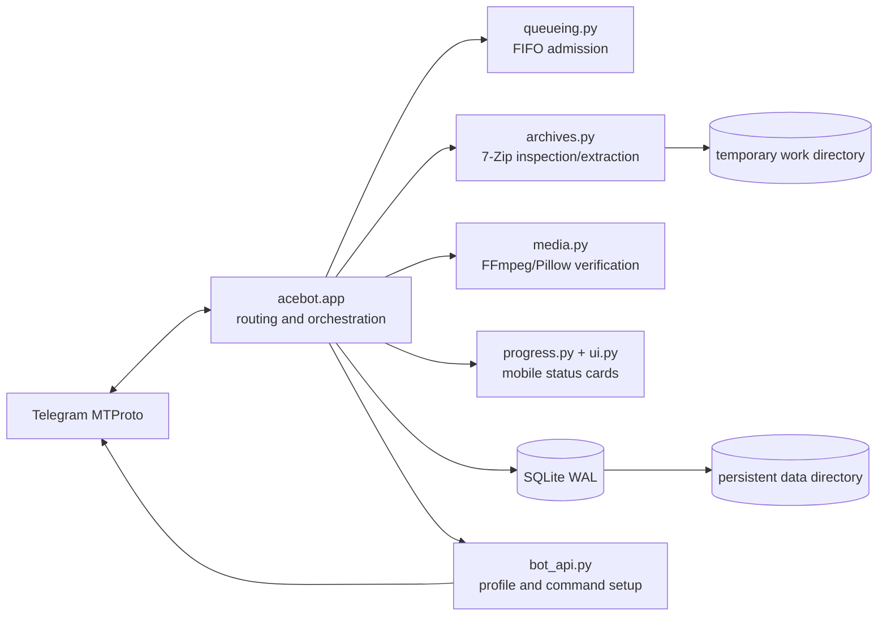

# Architecture

AceUnzipBot is a single-process asynchronous Telegram worker. It intentionally keeps deployment
simple: one bot process, one SQLite/WAL database, one persistent data directory, and isolated
temporary workspaces.

## Request lifecycle

```mermaid
flowchart TD
    U[Telegram user] --> A{Access allowed?}
    A -- No --> X[Reject or offer access request]
    A -- Yes --> C{Submission mode}
    C -- Single --> R[Resolve owner delivery route]
    C -- /bulk --> B[Collect message references]
    B --> V[/donebulk validates names and sizes]
    V --> R
    R --> Q[Per-user FIFO queue]
    Q --> W[Available global worker]
    W --> D[Download with progress and FloodWait recovery]
    D --> S[7-Zip technical listing and safety checks]
    S --> P{Password required?}
    P -- Yes --> K[Ask user; keep password in memory]
    K --> E[Extract in isolated workspace]
    P -- No --> E
    E --> M[Inspect each non-empty file]
    M --> T{Telegram-compatible media?}
    T -- Yes --> TM[Media upload with verified thumbnail]
    T -- No --> TD[Plain document upload]
    TM --> F[Thumbnail-free then document fallback]
    TD --> O[Deliver to selected targets]
    F --> O
    O --> N[Relocate one progress card to chat bottom]
    N --> Z{More files?}
    Z -- Yes --> M
    Z -- No --> L[Sanitized optional log and completion]
    L --> G[Delete temporary workspace]
```

## Runtime components



## Queue invariants

- The default is one global worker.
- The owner may select up to eight global workers.
- A user never has two active archives at once, so that user's arrival order remains strict.
- Queued Telegram messages are references only; downloads and disk reservations begin at worker
  admission.
- Bulk validation produces one aggregate queue confirmation. A progress card is created only when
  each archive starts.
- `/cancel` reaches queued, downloading, extraction, upload, mirror, and FloodWait states.

## Upload decision tree

Every non-empty regular extracted file is attempted. Extension alone never determines media mode.
The media inspector first validates content with Pillow or FFprobe. Confirmed media gets an upload
attempt with appropriate attributes and, for streamable video, a JPEG thumbnail. Telegram media
validation errors degrade to a thumbnail-free form and finally a plain document. One exhausted
file is counted and skipped; it cannot cancel later files.

## Optional logging circuit

`LOG_CHANNEL_ID` is only a bootstrap preference. The owner can replace or disable it in `/admin`.
When no channel is active, log methods return immediately. If a stored archive reference fails but
the channel can still receive text, sanitized metadata is sent instead. If the channel itself is
unreachable, log delivery is disabled in memory for the remainder of that process; archive jobs
continue normally. A successful owner test clears the circuit.

## Trust boundaries

| Boundary | Enforcement |
| --- | --- |
| Telegram user → bot | Owner/private/public access policy, ban list, owner-only routing |
| Archive → filesystem | Technical listing, traversal/link checks, byte/file/ratio limits |
| Extracted file → Telegram media | Content verification, attribute construction, safe fallback |
| Secret → diagnostics | Redacted doctor output; passwords never persisted or forwarded |
| Bot → host | Unprivileged systemd user or UID 10001 container, explicit writable paths |

The hand-drawn product flow is available as a [one-page PDF](AceUnzipBot-Workflow.pdf).
